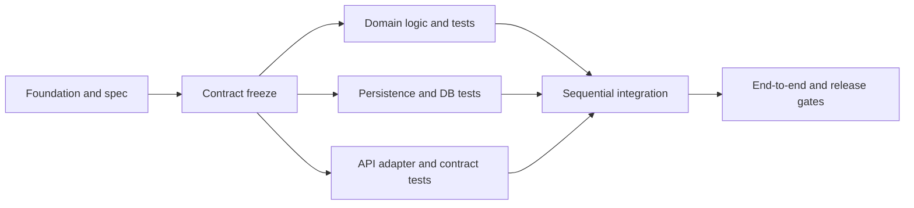

# SDD, DoD and future worktree parallelism

[GitHub Spec Kit](https://github.com/github/spec-kit) describes Spec-Driven Development as requirements → specification → technical plan → actionable tasks → implementation. We use **spec before code**; toolkit installation/commands are optional. Preserve existing `specs/`, `.specify/` or other project conventions, with canonical ADRs in `.palarran/`. This skill ends with planning artifacts, never implementation/merge/convergence.

## Traceability and gates

Stable IDs: `R-*` requirement, `AC-*` acceptance, `INV-*` invariant, `C-*` contract, `T-*` test, `TASK-*` agent task. Matrices link these to design/ADRs, planned code touch sets, rollout checks and DoD. This is our convenient notation, not a GitHub standard. Spec changes need impact maps/versions, never silent contract fixes in one lane.

- **Foundation ready:** stack/architecture/data/contracts/infrastructure fit defined or explicitly reused; critical unknowns resolved.
- **Plan ready:** feature scope/AC/invariants, architecture/data/cache/performance/reliability, tests/rollout/recovery, task DAG and ownership are specific enough for the next agent. Blocking spec decisions mean draft/conditional, not ready execution.
- **Future task DoD:** in-scope implementation, linked AC/tests, actual check outcomes, contract/migration compatibility, safe evidence/review; scoped branch commits/artifacts without unrelated changes.
- **Future feature DoD:** integrated code on integration baseline, all critical AC/invariants/edges, contract/data/concurrency/load/recovery gates and agreed SLA/SLO checked in the required environment; rollout readiness/runbooks. Unchecked SLA/performance never becomes PASS through completed tasks.

## DAG instead of five agents editing everything

First the contract/schema owner freezes shared baselines. Domain logic, persistence adapters and API-adapter tests may then be independent in different touch sets. Tasks needing unfinished interfaces wait for contract freeze or use agreed stub-only scope; stub tests do not prove real integration.

This is an example, not three mandatory lanes for every project. Specify critical paths, maximum concurrent agents under CPU/RAM/DB/CI budgets, expected independent work and serial conflicts. Small features may use max=1 with reasons and explicitly absent independent lanes; otherwise worktree overhead consumes speedups. Never promise multiplicative speedups without evidence.

## Worktree plan: do not execute

[Git worktree](https://git-scm.com/docs/git-worktree) gives separate working trees/index/HEAD with shared Git repository components. It isolates source checkouts, **not** secrets, OS processes, ports, databases, caches, remote refs or cloud state. Each future lane therefore specifies:

- Base commit SHA and integration-branch policy; parent dirty/untracked changes do not enter new worktrees automatically. Identify source artifacts that must be committed before start without committing others' work for the user.
- Unique branch/worktree path, allowed/forbidden files/modules; schema-migration numbering, API schema/codegen, lockfiles/shared configs need one owner/serial task.
- Isolated DB/schema/test tenant, queue/cache namespaces, ports/temp/output directories, sandbox credential refs without values; total connection/worker budgets. No shared-DB destructive tests.
- Input spec/contract revision, dependencies, outputs and exact future checks/DoD; safe evidence/handoff for integrators. Agent prompts must not authorize unilateral source-contract changes.
- Integration order, baseline updates, conflict-resolution owner; after merge/cherry-pick per project policy rerun affected suites + integrated end-to-end checks. Indexes/ADRs also need merge ownership so agents preserve context.
- Cleanup only after preserving/integrating results and checking dirty/untracked state. No automatic `remove --force`, deletion of others' branches or credentials.

Plans may show future `git worktree add -b <task-branch> <isolated-path> <frozen-base-sha>` with placeholders; **do not execute** now. Checkouts do not replace dependency ordering. Dispatch future tasks through [templates](../../templates/agent-task.md); `/palarran:backend:plan` launches no implementation agents.
