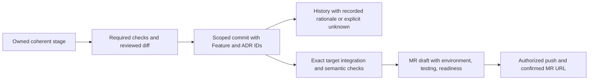

# Git workflows for agents

Four skills turn an owned stage into a reviewable commit, explain a file's recorded history, resolve conflicts with an explicit target branch, and prepare/publish an MR or PR within actual authorization. Start with the selected guide: [commit](commit.md), [history](history.md), [conflicts](conflicts.md) or [MR](mr.md), plus [dated primary sources](sources.md).

Read [feature lifecycle](../../../core/agents/docs/feature-lifecycle.md), [decision memory](../../../core/agents/docs/decision-memory.md), [global memory](../../../core/agents/docs/global-memory.md), current target AGENTS and actual project conventions. Library and target are different roots. Read the target private index/relevant accepted ADRs and preserve legacy `.ai-development/` context when present. Global experience is evidence to recheck, not permission or a substitute for the current diff. Offline/unavailable recall is DEFERRED; do not install/repair memory automatically.

## Scope, identity and ownership

An invoked commit skill or authorized feature build may create the coherent owned stage commit under the user's standing per-stage policy. File-history review is read-only. Conflict resolution changes only the explicitly chosen owned feature integration; MR publication and push use the user's actual requested scope. Installing/reading these instructions grants no action. `--plan` for any workflow is offline inspection and inert private planning only: no branch/worktree creation, staging, commit, merge/rebase, fetch/push, platform calls or application checks.

A feature uses the stable user-provided or lifecycle-generated Feature ID. A new normal feature starts from the verified remote default commit under the lifecycle contract; existing work retains its branch/base and is not restarted merely to make a Git task look clean. Missing remote freshness in offline work remains NOT_RUN. Every stage commit carries `Feature: <id>` and relevant `ADR: <decision-id>` trailers without publishing private journal contents. Preserve accepted rationale and superseded history; do not fabricate an ADR ID to fill a trailer.

Inspect repository/worktree, HEAD, merge/rebase/cherry-pick state, staged/unstaged/untracked changes, actual path/hunk ownership, required checks, hooks/signing and branch policy before mutation. Commands use argument arrays, literal paths and `--` where appropriate; never interpolate branch/file/message text into shell code. Do not output credential-bearing remote URLs. Review code/config hooks before running a project's toolchain; never silently bypass required hooks/signing or alter user Git identity/config.

One coordinator owns shared index/branch integration. Parallel implementation uses already authorized isolated Git worktrees with non-overlapping files/resources; dependent Git mutations stay sequential. Never use `git add .`, `commit -a`, implicit stash/pull/reset/clean, checkout-theirs/ours across a tree, forced checkout, automatic amend or force-push to make unrelated dirt disappear. A conflict or failed hook is not permission to discard someone else's changes. Preserve unknown remote outcomes and reconcile the exact branch/MR before retrying publication.

## Durable result

Target `.palarran/git/<task>/` records context, accepted decisions, pre/post subjects, ownership boundaries, actual checks, commit IDs, report/draft locations, remaining gaps and handoff. Use `languages.docs` for generated narrative and repository conventions for public commit/MR text; canonical framework instructions remain English. Secret values, raw customer logs and private journals never enter commits or MR bodies. Feature/ADR identifiers provide traceability without exposing the journal.

Read-only history may write its requested private explanation and decision/handoff records; that does not authorize changing application or Git history. A draft MR description is a local artifact until the platform confirms creation. Neither a commit, conflict-free index, green local checks nor a published MR proves production readiness or an operational SLA.

The diagram describes workflow boundaries; it authorizes no execution. Source versions and actual checks stay attached to each transition. Missing checks remain NOT_RUN, even when the work is a useful checkpoint.
