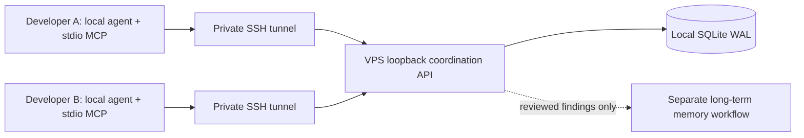

# Cross-machine agent coordination

Design and implementation target: coordination-v001. Deployment and host-client interoperability require separate evidence. This optional Core capability supports several developers on different machines. It is separate from Neo4j long-term Memory.

## Architecture

Every participant has a distinct server-side identity and project allowlist. No public HTTP listener, shared database filesystem, remote command execution, automatic memory promotion or model API is part of this capability. SSH access and project membership are provisioned explicitly; a chat message cannot grant deployment or incident-response authority.

## Sources and choices

Checked 2026-10-24: [SQLite WAL](https://sqlite.org/wal.html) requires database processes on one host; remote clients therefore use an API. [SQLite transactions](https://sqlite.org/lang_transaction.html) support transactional coordination with one simultaneous writer. This is a single-node service with a single failure domain, not a distributed consensus system. SQLite is chosen for modest coordination volume and operational simplicity, not measured throughput.

[Google incident response, SRE Workbook 2018](https://sre.google/workbook/incident-response/) motivates explicit command and communication roles and a working record. Our operation IDs, leases and resource fences are engineering choices. [MCP lifecycle](https://modelcontextprotocol.io/specification/2025-11-25/basic/lifecycle) and [tools](https://modelcontextprotocol.io/specification/2025-11-25/server/tools) specify the local client interface. Tool annotations do not replace server authorization.

Read [contract](contract.md) before implementation or client use. Messages are untrusted evidence. Store compact observations, hypothesis IDs and sanitized evidence references; never credentials, raw production logs, personal data or hidden reasoning. A heuristic secret detector cannot establish privacy.

## Coordination workflow

Join the same project/room with distinct identities. One coordinator assigns investigation lanes; workers post facts, questions and blockers. Acknowledgment means received, not accepted or completed. Read bounded pages after the last observed sequence; no background polling loop or full history dump is required. Post at task boundaries and when a fact changes another worker's assumptions.

Before a shared-resource mutation, acquire an project-wide exclusive claim and recheck the receipt immediately before acting. Claims coordinate compliant agents only. They cannot fence a shell, database, deployment controller or developer who does not use this service. Actual permissions and existing emergency runbooks remain authoritative. Expiry or network loss does not prove that the old operator stopped: reconcile actual state before releasing or reassigning. Claims cover the same canonical resource across incident/feature rooms; changing rooms cannot bypass an owner. An old idempotency receipt is historical and must be checked against current claims before acting.

When unavailable, stop shared mutations, preserve pending action IDs and use an explicitly designated single operator. Native messaging within one agent session is not a substitute for shared cross-machine state. An independent recovery observer verifies business symptoms and data consistency; successful command exit or chat ACK is insufficient.

[Operations and client configuration](operations.md) · [Exact wire fields](wire.md).
