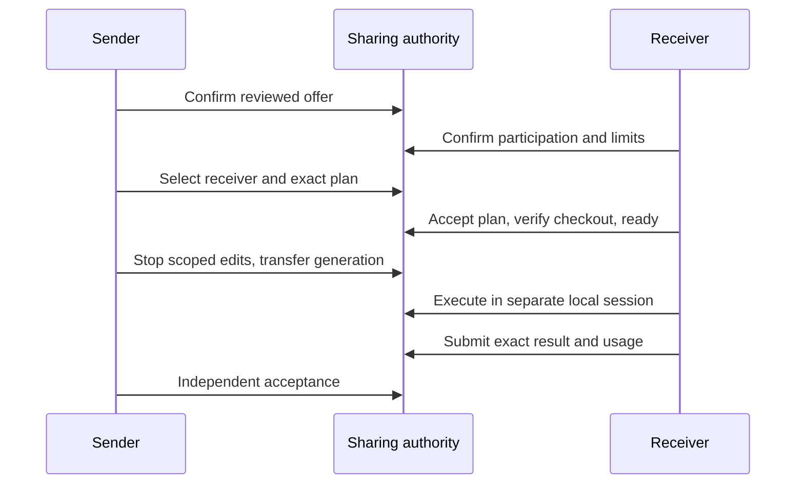

# Task sharing v001

User specification v0.3, checked 2026-10-24. `/palarran:core:share` proposes a new task or a continuation. Sharing transfers scoped responsibility, never accounts, authorization files or subscription quota. This contract precedes implementation.

## One authority

Local backend stores the lifecycle in the existing authenticated CoordinationStore transaction, alongside durable operation receipts and notification messages. Temporal backend uses one Workflow as the lifecycle authority, with no local mirror capable of transitions. The bus carries notifications/discussion; ACK is delivery only. A trusted gateway obtains explicit human confirmation from each side; an agent token is not technical proof of a human action. Do not expose a generic auto-approve tool to agents.

Pure reducer API: `create(offer, actor, now)` and `apply(state, event, actor, now)`, returning JSON-compatible state or raising `ShareError` with safe enum. Both are deterministic, have no network/files/subprocesses and enforce bounds. `offer` keys: `share_id, task_id, run_id, repository, room, mode(new|continue), plan_hash, base_commit, expires_at, card, scope, limits, backend(local|temporal)`. Optional `previous_share_id` links renegotiation/return history. `card` has `goal, outcome, estimate, uncertainties, tools, data_categories, checks`; no quota numbers or secret values. `scope` has `files, resources, actions, contracts` (bounded lists of safe relative paths or opaque aliases); `limits` has `tokens, cost_micros, seconds`. Plan hash binds exact complete reviewed packet held privately. Card is explicitly privacy-reviewed before publication; no automatic raw journal import.

`event` keys: `event_id, kind, assignment_generation, plan_hash, data`. Server-authenticated actor is separate. Sender confirms `create`; receiver confirms `offered` including its own frozen limits and `offer_id`. Sender chooses `assigned` with `offer_id`; compare-and-swap state permits only one. Sender `plan_proposed`, receiver `plan_accepted`. For continuation sender then records `checkpoint_published` with exact checkpoint SHA, safe remote/branch aliases and `evidence_sha256`; this is evidence from the separately authorized Git helper, never a claim that Git copied external processes. Receiver `receiver_ready` binds exact base/checkpoint SHA, `evidence_sha256` and a distinct `session_id`/`local_run_id` after local prerequisite checks. Sender `ownership_transferred` requires `stopped=true`, `unknown_operations=false`, `usage_known` and counters (unknown usage is allowed explicitly and retained); it increments generation atomically. Receiver then `started`, bounded `progress`, `result_submitted`. Sender independently `accepted` with matching subject/evidence hashes or `rework_requested` (no replay of a previous launch; use a fresh attempt and reserved budget). Either party `cancel_requested`; active receiver `cancelled` requires stopped proof and preserves usage/late evidence. Expiry prevents negotiation/start but never proves a running process stopped or reassigns ownership. Unknown operations block transfer; loss of contact keeps `handoff_pending`.

Every response preserves IDs, generation, exact plan hash, event time/deadline and attempt history. Event IDs deduplicate exact payloads; conflicting reuse is rejected. State contains at most 32 offers and 256 events. No silent retention. Material changes create a new consent round linked to prior share, without dropping spend/history or changing an active owner. No event can expand the frozen plan/scope/budget. Trusted local dispatcher integration must reserve receiver capacity in a separate run/session and fence stale generations before work. A durable start intent with an unknown reply is reconciled, never launched again.

## Wire and failure

Local operations: `share.create` (`project, request_id, offer, confirmed=true`); `share.event` (`project, request_id, share_id, event, confirmed=true` for consent-bearing events); `share.get` (`project, share_id`). Principal identity/project access is inherited from the existing service. The gateway must require actual confirmation before passing `confirmed`; it is an explicit assertion, not attestation. Backend temporal is rejected by local share operations. Unknown delivery reconciles original `operation.get`. Notifications contain only share ID/event/generation/digest; participants retrieve the reviewed card in their authorized project. Shared room access follows existing project scope; rooms do not provide per-recipient privacy.

No automatic push, PR publication, launch, installation or deployment. Git checkpoint requires exact owned paths, hooks and an explicitly permitted non-default remote branch; lost push response reads remote SHA before replay. Receiver fetches into a fresh worktree from exact SHA, preserving its existing checkout. Private ignored materials are separately selected and privacy-reviewed by hash. Tests use disposable clones/local HTTP/fake SDK, not people, paid models or subscriptions. Physical multi-machine and live Temporal recovery remain NOT_RUN until observed.

## Basis

Primary sources checked 2026-10-24: [Temporal Python message passing](https://docs.temporal.io/develop/python/workflows/message-passing) provides Queries/Signals/Updates; [Temporal message semantics](https://docs.temporal.io/encyclopedia/workflow-message-passing) distinguishes synchronous tracked Updates from asynchronous Signals. [Git worktree](https://git-scm.com/docs/git-worktree) provides isolated working trees; [Git push](https://git-scm.com/docs/git-push) describes exact refspecs and rejected updates. Our approval, generation and privacy gates are engineering choices, not vendor guarantees.
