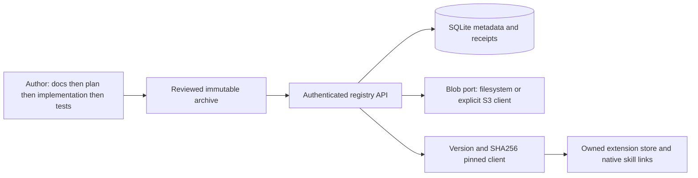

# Custom packages and registry

Checked2026-10-25. Packaging adds a source-backed extension workflow to Core, without making downloaded instructions trusted framework code. Read the [exact contract](contract.md), [sources](sources.md), [creation workflow](create.md), [client lifecycle](lifecycle.md), and [operations](operations.md).

Public/private is selected before publication. Public listed releases appear in search; private releases are visible only to the owner and operator-configured readers. Delisting removes discovery, not exact pinned retrieval. Deletion creates an unavailable tombstone and cannot reuse the version. Previously downloaded public content cannot be made private retroactively.

The default is a small single-instance Python service with local content-addressed storage. An injected S3 client adapter supports a preprovisioned private bucket; the registry does not implement S3 or create paid storage. No cache, distributed consensus, external package dependency solver, automatic hooks or MCP activation is part of v1. Built-in prerequisites must already be installed.

A digest detects content changes; it does not certify an author's identity or an instruction's safety. Review package instructions/resources and required tools before exposing them to an agent. Installed helpers remain inert until separately authorized work invokes them. Current project instructions and source remain authoritative.
