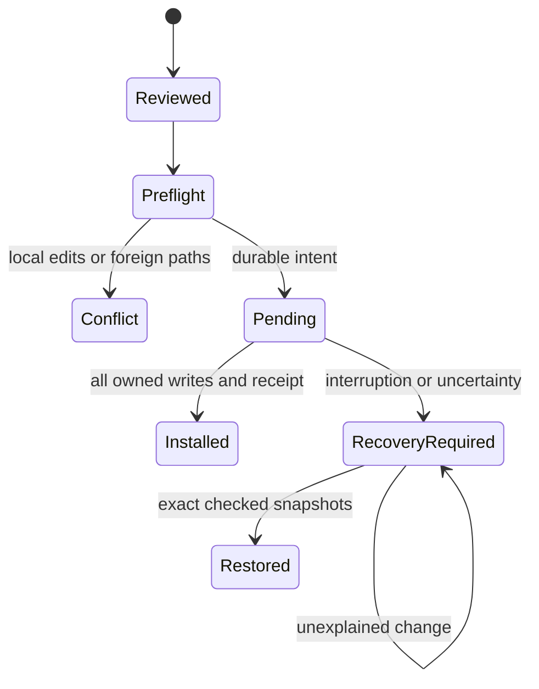

# Search, install, update, uninstall and owner withdrawal

Use exact publisher/name, version and SHA256. Search is discovery, not trust. `list` separates local installed receipts from the caller's owned registry releases; a read/list never performs withdrawal. Explicit owner delist/delete uses dedicated operations.

## Client profile

Private `.env` may define `PACKAGING_URL` and `PACKAGING_TOKEN`. If either project key is present, use that project profile only; otherwise read `~/.palarran/.env`. A project URL without a token is anonymous, never a reason to borrow a global token. This prevents cross-registry credential mixing. HTTPS or an explicit numeric loopback HTTP tunnel endpoint is required. Tokens use private file/profile references, never command-line values or logs. Setup never creates credentials automatically.

## Local ownership

A framework-installed target is required. Built-in prerequisites are checked from its receipt; install does not expand its selected packages. External archives live separately under `.ai-tools/packages/<publisher>/<name>`, with ownership metadata under `.palarran/packages/` and project-local Claude/Codex discovery links. They do not replace builtin skills, root AGENTS/CLAUDE instructions, MCP config, .env or global preferences.

Preflight verifies the entire owned state before mutation. Modified files, foreign extras/links, origin drift or a pending transaction stop the operation. Update inherits its recorded native client scope. Changing that scope is unsupported in v1 and fails closed; an omitted CLI flag never silently drops Codex/Claude links. Update never uses a blind overwrite/force path. Uninstall removes only exact owned content and discovery, preserving unrelated files/configs and recoverable operation evidence.

A local lock and durable transaction record protect cooperating installer processes. Multi-file replacement is recoverable, not a filesystem-wide atomic transaction for arbitrary readers; stop agents using those skills during update. A crash leaves an explicit pending operation. Recovery checks old/new snapshots and restores only demonstrably owned paths. Unexplained changes remain recovery_required, never silently adopted or deleted.

`--plan` is inert as specified by the chosen CLI/API: the skill/CLI plan path must return before config/network/writes; an explicit local installer API preview may read its supplied archive/target only. No operation executes package imports/hooks or activates optional services. Package instructions are untrusted content until reviewed.

