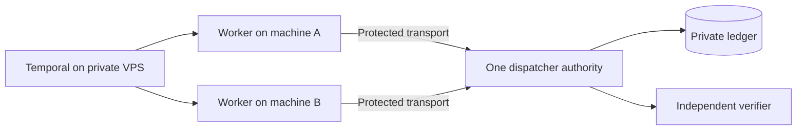

# One authority across worker machines

The authoritative dispatcher and independent verifier run on an approved coordinator machine. Developer-machine workers reach its loopback HTTP endpoint through an explicitly configured protected SSH tunnel. The VPS Temporal Service stores only bounded metadata and hashes; the authority stores the private task packets and one durable accounting ledger. No developer credentials are moved to the VPS.

Run the reviewed local factory with `python3 -m packages.core.parallelism.authority --factory approved_module:authority --port 18793`. It returns the Dispatcher, trusted independent verifier and principal scopes. Each principal key is the SHA256 of a random token, with explicit runs, task IDs and control boolean. Ordinary worker credentials cannot cancel an entire run. The worker factory returns `RemoteDispatcher('http://127.0.0.1:18793', private_token_file)` through the owned tunnel and its local approved harness adapter. Endpoint redirects, proxies, non-loopback binding and public credential transport are rejected. This is a private control service, not a public multi-tenant API.

Claim/reservation, heartbeat, finish and acceptance all pass through the same authority. A transport failure after claim or finish remains unknown; inspect the original run instead of spawning a second process. Deadline and cancellation checks return through heartbeat; cooperating adapters must call it frequently and prove stopped. A missing worker cannot be declared cancelled until reconciliation. Restart reopens the same ledger, never a copied independent SQLite state.

Worktree paths and task bindings are approved for each execution machine before dispatch; the server does not clone repositories, install tools, transfer raw source or grant arbitrary filesystem access. The coordinator verifier needs an authorized exact result/artifact channel and hashes. A callback claiming independent=true is a trusted integration assertion, not automatic proof that the same model did not judge its own work.

Nested planners must register bounded children, then submit their decomposition and terminate before children requiring the same ownership execute. Holding parent mutation claims while waiting for children is unsupported; do not create waiting manager trees or consume all slots with supervisors. All descendants share the immutable root launch/token/cost limits and backend. The current scheduler uses configured maximum and ready work, not a learned optimal capacity model.

Offline tests run multiple authenticated clients over loopback and synthetic adapters; actual cross-machine SSH, Temporal deployment and model quality require separate permitted acceptance. These statuses remain NOT_RUN until exercised.
