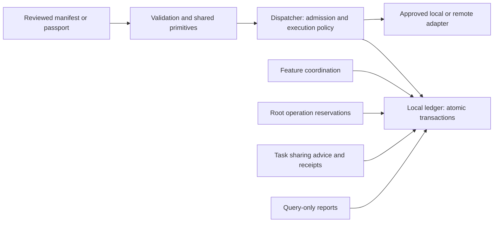

# Core internals for contributors

Core separates input validation, durable local storage and execution policy. Structural helpers are pure; manifest worktree validation also checks local path type and symlinks without changing files. A refactor must preserve the same JSON values, canonical hashes, SQLite rows, single root budget and admission/unknown-outcome fences. Read [the execution contract](contract.md), [feature contract](features/contract.md) and [ledger interface](ledger-contract.md) before changing behavior.

## Where a change belongs

| Concern | Module | Invariant |
| --- | --- | --- |
| Bounds, identifiers and canonical JSON | `primitives.py` | No I/O or lifecycle imports; preserve exact canonical bytes |
| Manifest and DAG validation | `manifest_validation.py` | Bounded structural validation and read-only worktree checks; dependencies and permission inheritance remain explicit |
| Feature passport validation | `feature_validation.py` | Pure ownership, contracts, invariants, acceptance and release checks |
| Named lifecycle values | `states.py` | String-valued enums keep stored/serialized values compatible |
| Local transactions and root reads | `ledger.py` | One SQLite authority; read-only mode never initializes or migrates state |
| Scheduling and task accounting | `dispatcher.py` | Durable admission before launch, cumulative budget, no replay of unknown work |
| Business composition and rollout | `feature.py` | Frozen criteria and exact composition; callbacks cannot rewrite expected data |
| Supervised independent checks | `feature_gates.py` | Registered code/criteria, exact atomic claim binding, stop proof and root usage |
| Transport and observation | `authority.py`, `dashboard.py` | Scoped authenticated access; query views do not mutate leases or infer approvals |

## Extend one rule

1. Locate the existing manifest/passport validator and its focused tests. Add a named pure helper for one domain rule; reject unknown fields and booleans-as-numbers where the existing contract requires it.
2. Preserve canonical normalization and exception behavior for unchanged inputs. A parser refactor cannot silently accept previously rejected configuration.
3. Keep new operations inside the existing ledger transaction when admission, ownership or reservations must be atomic. Use the public ledger port rather than another component's private methods.
4. Freeze test criteria outside the implementation. Add a negative case, an exact-subject regression and recovery/cancellation coverage for affected behavior.
5. Verify a pre-existing database can reopen without resetting spend or changing the backend. Do not silently create a migration, replacement ledger or retry policy.
6. Update explicit portable exports and test imports from an exported plugin without the source checkout.

Named states improve code navigation; they are not a new wire protocol or an automatic state-machine validator. SQL literals and JSON strings remain stable. The ledger port is a trusted local extension boundary, not an authorization API or an OS sandbox. Remote workers still use the authenticated authority.

## Sources and design choices

Checked 2026-10-24: official [Python Enum](https://docs.python.org/3.9/library/enum.html), [Protocols](https://docs.python.org/3.9/library/typing.html#typing.Protocol) and [context managers](https://docs.python.org/3.9/library/contextlib.html#contextlib.contextmanager) document the mechanisms used here. Python 3.9 compatibility is retained for existing users; these pages explicitly identify it as an older unsupported Python release. The module boundaries, compatibility wrappers and no-migration policy are Palarran engineering choices. Type annotations document a port; they do not enforce permissions or runtime invariants.
