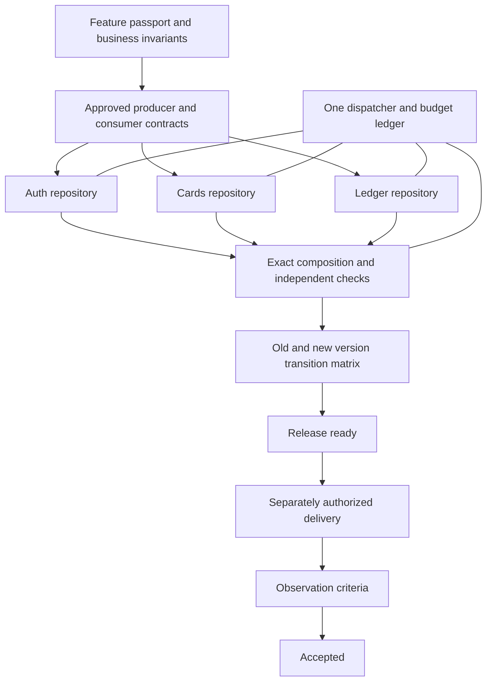

# One feature across repositories

A feature has one business goal, versioned passport, coordinator, task DAG and root budget across all participating repositories. Independent service PRs are necessary evidence; readiness belongs to the exact combined service composition. Start with the [contract](contract.md), [workflow](workflow.md), [acceptance and release guide](acceptance.md) and [primary sources](sources.md).

The coordinator stores canonical private material in `.palarran/features/{feature_id}/`; participants keep bounded approved references and their local task packets. Worker machines use the existing [scoped dispatcher authority](../authority.md), protected transport and their own credentials. The message bus sends notifications, never authoritative state or execution permission. Optional Temporal schedules the same root run; it neither receives a cloned budget nor silently falls back to local execution.

This capability coordinates trusted project-specific checks. It does not infer business semantics from matching JSON fields, transfer accounts, merge PRs automatically, promise atomic service releases, or establish production health from synthetic examples. Every report names actual checked commits and missing evidence.
