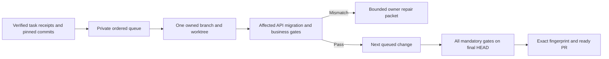

# Smart integration queue

The queue turns independently verified task commits into a checked combined candidate. It does not publish a PR. Read [sources](integration-sources.md), the shared decision-memory contract and Git workflow guides first.

## Admission

`IntegrationQueue(db_path, gate_registry=..., budget_binding=...)` stores state outside every source/candidate worktree. The registry is trusted coordinator code/config, never generated by a worker. `create(run_id, repo, base_commit, branch, worktree, items, required_gates)` freezes exact commits, branch, item order, verified task-receipt hashes and the gate registry. Every item declares `impacts`, mapping each affected API/migration/shared-component/business contract to gate IDs; omissions are a planning coverage error, not proof of compatibility. `gates` includes all impacted gates. Required final gates must include the union of affected gates.

Task receipts are private regular JSON files, with exact SHA-256 and fields `task_id`, `status=verified`, `subject=source_commit`, `independent=true`. This is a provenance boundary: the trusted coordinator must have produced the independent receipt; a worker-created JSON file is not independent verification. Each item declares its pinned `source_base` (initially the queue base) and verified source HEAD. The entire bounded linear commit series `source_base..source_commit` is applied in order, preserving intermediate implementation stages. Merge histories or non-linear ranges are rejected rather than silently applying only the last commit. Upstream freshness is established by the already authorized feature workflow; this queue neither fetches nor guesses a default branch.

`prepare()` creates only a new `codex/` integration branch and a new owned worktree. Source checkout dirt and unrelated refs are preserved. Each `advance()` applies at most one queued commit, then runs its declared gates in order. A failed semantic check leaves the candidate available for review, blocks later items and creates a private repair packet addressed to that item's owner with contract/expected/actual/evidence references. A textual conflict is aborted only when its sequencer source, sequence-start HEAD and owned branch match this queue's intent. Git hooks remain enabled inside the bounded mutation process; source repositories and their configured hooks must be trusted. Metadata reads disable fsmonitor. This is not a sandbox for hostile repositories. No shared reset, force update, stash, cleanup or automatic worker message occurs.

## Checks, cost and recovery

Gate specifications contain explicit absolute argv, timeout, bounded output, environment and immutable external script pins. Commands run through the existing bounded process-group runner; stdout/stderr are hashed rather than stored. Each gate writes a bounded private JSON receipt through `PALARRAN_GATE_RECEIPT`, receives `PALARRAN_GATE_SUBJECT`, and reports `passed`, exact `subject`, `contract`, short safe `expected`/`actual` summaries and `evidence_sha256`. Its code pins must be outside application worktrees. Missing, malformed, stale or drifted receipts fail acceptance. A timeout or unobserved outcome remains unknown. The runner is a supervisor for trusted code, not a hostile-code sandbox.

The required root budget binding has `reserve(run_id, phase, item_key)`, `heartbeat(ticket)` and `settle(ticket, outcome)` methods. Reserve returns a nonempty existing-root ticket or denies; no local budget is created. Phases are `integration` and `verification`. Stable initial item keys are `prepare`, `ITEM/git`, `ITEM/gate/GATE` and `final/GATE`, including `final/acceptance`. Repairs use `ITEM/repair-N/git` and `ITEM/repair-N/gate/GATE`; later final attempts use `final/attempt-N/GATE`. Slots must be predeclared at the root; absent spare capacity blocks a repair rather than increasing limits.

The concrete `DispatcherBudgetBinding` maps each key to an already approved external root task; external operation slots must never run through the normal agent scheduler. Operation bookkeeping slots may be optional for completion, while the final business acceptance task remains required. An unattempted required final acceptance slot may be mapped to the later final-attempt key; an attempted or unknown slot cannot be replayed under an alias. Active and unknown optional operations still count against the shared limits.

Every bounded Git/gate process receives the root ticket heartbeat. Known settlement requires actual process-group stop proof, then records `passed`, exact `subject`, `evidence_sha256`, elapsed `seconds`, `stopped`, zero model `tokens` and zero model `cost_micros` for these command-only operations. Unknown outcomes retain reservations. A known negative semantic check is a verified completed operation, while the queue stays blocked on its mismatch; it is not business acceptance. The coordinator configures an independent root verifier outside the queue. It must check actual stage evidence and the aggregate final fingerprint/gates for `final/acceptance`. Queue readiness requires that separate root acceptance receipt. Authorization to integrate does not authorize model calls or increased limits.

SQLite records intent before every external mutation, check, root reservation and settlement; active root tickets are durable. Receipt reads are bounded regular-file reads, hashes bind those same bytes, and duplicate/nonfinite JSON is rejected. A pending operation discovered on reopen becomes `unknown`; it is never replayed. `reconcile(expected_head=..., processes_stopped=True, budget_reconciled=True)` is an explicit operator assertion after independent session/filesystem review: it checks actual HEAD and branch, then leaves a blocked queue requiring a reviewed repair, not automatic replay. Unknown accounting must also be reconciled at the root budget authority. Never use absence of a heartbeat as proof that Git or a gate stopped.

A repair uses `replace_blocked(item_id, new_source_commit, receipt_file, receipt_sha256)`. New receipt/commit provenance is checked against the same task identity and a source range based on the current candidate; the old failed attempt and repair packet remain. Previously applied bad code is not erased: repair commits must build on the current candidate, and are integrated as another reviewed change with the original gate coverage. A failed earlier item cannot be silently skipped. All subsequent candidate mutations invalidate final readiness.

`finalize()` requires every item integrated, then reruns all mandatory gates on the exact final HEAD and fingerprint. The fingerprint includes tracked/untracked content; gate checks must leave the candidate clean and unchanged. `report()` rechecks the fingerprint before reporting `pr_ready=true`; drift yields a blocked result. The report contains safe IDs, owners, commits, gate states, remaining items, repair IDs and `publication=not_requested`. A final-gate repair is assigned to the latest declared contributor for that gate, and the packet lists all declared contributors; this is a routing policy, not a claim that causality was proven. Read-only consumers may instantiate `IntegrationQueue.__new__`, attach an existing `mode=ro`/`query_only` SQLite connection and call `report()` without invoking recovery or schema creation. Creating/pushing a PR is a separate authorized action, with environment/test/readiness information from the Git MR contract. Passing this queue does not establish production readiness beyond its explicitly covered contracts.
