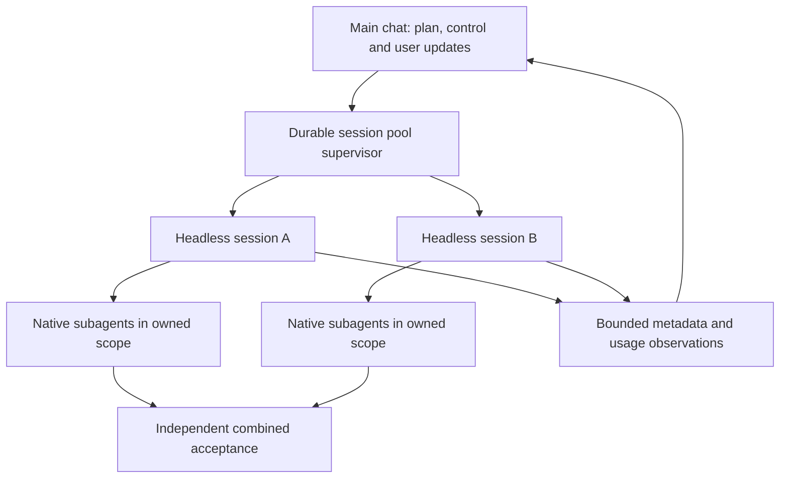

# Headless session pool

The main chat remains the coordinator. It prepares a reviewed task DAG, independent linked worktrees, model profiles, permissions and one cumulative run budget. A trusted binding selects `NativeTeamHarness`; the normal `NativeHarness` continues to prohibit native descendants. One task is one headless root plus its bounded team. The existing Dispatcher owns admission, reservations, cancellation, unknown outcomes and independent final acceptance.

## Semantics

`3 sessions × (1 root + 3 children)` is capacity12, not twelve observed agents. Reports separate configured capacity, admitted roots, observed active children, lifetime discovered children, observation completeness, known usage, reported lower bounds and held reservations. Unknown costs are not zero; provider API-equivalent estimates are not subscription quota percentages or invoices. The main chat's own usage is outside the subprocess ledger unless separately supplied and reconciled.

A team budget includes its descendants. Reserve the whole team before launch. Do not add a root aggregate and child counters together. Provider streams are version-dependent: only explicitly recognized lifecycle fields count as observations; text, thinking and arbitrary tool payloads never become instructions or persisted logs. When child-inclusive billing cannot be established, usage remains unknown and reservations stay held. A limit is reactive: an in-flight request can cross it. No automatic retries, increased budget or billing reconcilation by invention.

## Chat workflow

Prepare one reviewed binding and manifest, then start the local supervisor from the chat using the session-pool CLI. Read status or watch bounded metadata changes while working. Cancel one run through the shared Dispatcher. Resume means inspect the existing ledger and continue only unadmitted ready tasks; uncertain old attempts are never launched again. The supervisor can outlive a tool call; it is not an automatically installed service. A stopped chat does not receive unsolicited messages unless its environment has an explicitly configured notification consumer. Report actual integration rather than claiming native UI thread interception.

Native delegation is instruction-based, not a security boundary. Codex native concurrency can be configured per session; Claude native agent tooling requires explicit permission and a configured capability limit. All children inherit their root's owned scope and budget; native child worktrees, remote machines, escaped processes and hidden provider retries need additional observation/containment. Never claim active counts or complete cancellation without evidence.

## Sources

Read2026-10-26: [Codex non-interactive mode](https://learn.chatgpt.com/docs/non-interactive-mode), [Codex subagents](https://learn.chatgpt.com/docs/agent-configuration/subagents), [Claude headless](https://code.claude.com/docs/en/headless), [Claude subagents](https://code.claude.com/docs/en/sub-agents). These rolling guides do not prove installed CLI compatibility. Tests use inert local fake executables and real process/ledger paths; no paid provider calls.
