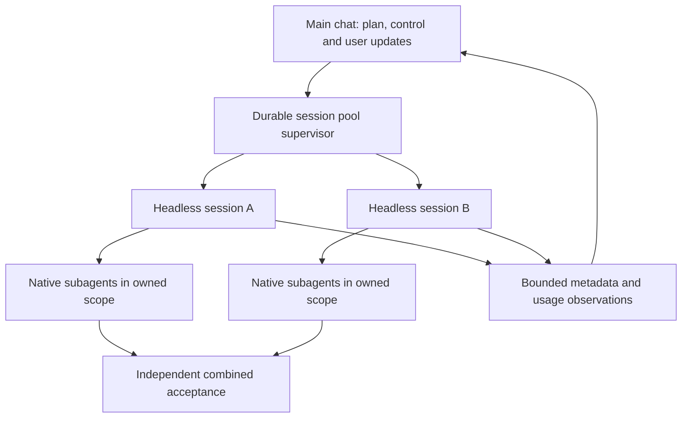

# Headless session pool

The main chat remains the coordinator. It prepares a reviewed task DAG, independent linked worktrees, model profiles, permissions and one cumulative run budget. A trusted binding selects `NativeTeamHarness`; the normal `NativeHarness` continues to prohibit native descendants. One task is one headless root plus its bounded team. The existing Dispatcher owns admission, reservations, cancellation, unknown outcomes and independent final acceptance.



## Semantics

`3 sessions × (1 root + 3 children)` is capacity12, not twelve observed agents. Reports separate configured capacity, admitted roots, observed active children, lifetime discovered children, observation completeness, known usage, reported lower bounds and held reservations. Unknown costs are not zero; provider API-equivalent estimates are not subscription quota percentages or invoices. The main chat's own usage is outside the subprocess ledger unless separately supplied and reconciled.

A team budget includes its descendants. Reserve the whole team before launch. Do not add a root aggregate and child counters together. Provider streams are version-dependent: only explicitly recognized lifecycle fields count as observations; text, thinking and arbitrary tool payloads never become instructions or persisted logs. When child-inclusive billing cannot be established, usage remains unknown and reservations stay held. A limit is reactive: an in-flight request can cross it. No automatic retries, increased budget or billing reconcilation by invention.

## Chat workflow

Prepare one reviewed binding and manifest, then start the local supervisor from the chat using the session-pool CLI. Read status or watch bounded metadata changes while working. Cancel one run through the shared Dispatcher. Resume means inspect the existing ledger and continue only unadmitted ready tasks; uncertain old attempts are never launched again. The supervisor can outlive a tool call; it is not an automatically installed service. A stopped chat does not receive unsolicited messages unless its environment has an explicitly configured notification consumer. Report actual integration rather than claiming native UI thread interception.

Native delegation is instruction-based, not a security boundary. Codex native concurrency can be configured per session; Claude native agent tooling requires explicit permission and a configured capability limit. All children inherit their root's owned scope and budget; native child worktrees, remote machines, escaped processes and hidden provider retries need additional observation/containment. Never claim active counts or complete cancellation without evidence.

## Sources

Read2026-10-26: [Codex non-interactive mode](https://learn.chatgpt.com/docs/non-interactive-mode), [Codex subagents](https://learn.chatgpt.com/docs/agent-configuration/subagents), [Claude headless](https://code.claude.com/docs/en/headless), [Claude subagents](https://code.claude.com/docs/en/sub-agents). These rolling guides do not prove installed CLI compatibility. Tests use inert local fake executables and real process/ledger paths; no paid provider calls.

## Commands from the main chat

All paths below are placeholders for private reviewed files. `--plan` on any command reads/writes nothing and launches nothing. The JSON manifest follows the existing dispatcher contract and includes exact source revisions, registered linked worktrees, owners, dependencies, limits and `max_workers`. `prepare` records it; it does not launch models.

```sh
python3 -m packages.core.parallelism.session_pool prepare \
  --state /PRIVATE/run.sqlite --run feature-1 \
  --manifest /PRIVATE/reviewed-manifest.json --authorized
python3 -m packages.core.parallelism.session_pool start \
  --state /PRIVATE/run.sqlite --run feature-1 \
  --binding reviewed_local_binding:factory --authorized
python3 -m packages.core.parallelism.session_pool status \
  --state /PRIVATE/run.sqlite --run feature-1 --format text
python3 -m packages.core.parallelism.session_pool watch \
  --state /PRIVATE/run.sqlite --run feature-1 --seconds 30 --after 0
python3 -m packages.core.parallelism.session_pool cancel \
  --state /PRIVATE/run.sqlite --run feature-1 --authorized
```

`start` acknowledges only a supervisor-start request. Inspect status for actual task admission and the private supervisor result. A POSIX lock admits one supervisor per run; a lost supervisor leaves attempts held by the Dispatcher, never silently replayed. A new supervisor can continue still-ready tasks after inspection; it cannot reset old running/unknown attempts. Local launch never falls back from a Temporal run. The child uses the inherited reviewed Python import path, not automatic project-module discovery. Keep `PYTHONPATH` explicit and reviewed.

The trusted factory signature is `factory(run_report, publish_metadata)`. It returns `{reviewed: True, adapter: NativeTeamHarness(bindings, authorized=True, max_subagents=3, publish=publish_metadata), verifier: independent_check, initial_workers: 3}`. `initial_workers` must fit the manifest's `max_workers`; the old dispatcher ramp-up remains the default for other entrypoints. Bindings use the existing NativeHarness fields (adapter, absolute executable, explicit model/effort, dated pricing, bounded prompt, explicit environment, source-subject callback, authorization). The factory is executable operator code, not a downloaded package or LLM-selected module. Verifier checks actual business contracts and exact commit; model completion alone is not acceptance.

A supervisor performs process cleanup and metadata collection in the background while the main chat is free for user messages. The main chat polls `status` or runs a bounded `watch`, then explains meaningful changes: active roots, observed children, assigned tasks, reported/unknown spend, held reservations and blockers. This does not write into another Codex/Claude chat or automatically wake a closed chat. A notification integration needs explicit host support. Raw model text and hidden reasoning are not persisted or surfaced.

## Provider capability and accounting limits

Codex uses `exec --json`, explicit native agent configuration and thread-tagged turn counters when present. Child lifecycle observations come from recognized collaboration tool items. Missing child usage leaves the task unknown even if its root reports success. Claude enables `Agent`, sets the documented concurrency/depth environment limits and uses `parent_tool_use_id`/tool IDs for observed children. Partial assistant message tokens are deduplicated by message ID; the top-level final `modelUsage` and `total_cost_usd` replace that lower bound once, not once per forwarded child message. Dollar estimates can therefore lag until a provider emits spend; the provider's own budget flag and the supervisor timeout remain separate safeguards. An inconsistent final counter does not erase already observed partial usage.

Native event schemas and limits vary by installed CLI. Unknown shapes never establish complete counts. Resumed agents, forks, native teams and other provider features may exceed documented ordinary-subagent controls; do not enable them through this binding. This implementation remains instruction-based: use trusted CLI profiles and external containment when stronger enforcement is required. No live Codex/Claude team run was used to certify these version-dependent surfaces in offline tests.

The CLI is run from the trusted library root with an explicit reviewed import path. `--plan` is the safe discovery mode. `--authorized` records the caller's real approval; a model must never invent that approval. Supervisor liveness is sampled privately; stale/failed supervision demands coordinator attention. A recognized human-question tool stops the headless attempt and surfaces a `needs_human` category without retaining its raw question payload. The main chat resolves it from the task context before any new authorized continuation.

The optional dashboard view uses `python3 -m packages.core.parallelism.dashboard serve --state /PRIVATE/run.sqlite --teams-state /PRIVATE/run.sqlite.teams.sqlite --run feature-1`. It reads both existing stores without changing them. The session pool handles at most the Dispatcher's reviewed32root workers; per-team capacity is1–32children. These are configuration bounds, not a measured throughput or a guarantee that the provider will make that concurrency available.
