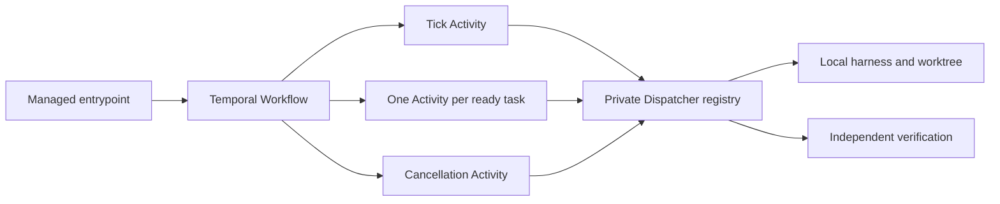

# Optional Temporal execution

Temporal coordinates the same dispatcher used by local execution; it does not replace its ownership, budget, descendant registry or independent verifier. Read [sources](temporal-sources.md) and the [hosting runbook](../../../infrastructure/hosting/docs/temporal-runbook.md) before operating it.



The Workflow only sequences bounded tick/task/cancel Activities and timers. Models, Git, verifier commands, process management, credential reads and accounting execute outside Workflow code. Temporal history receives opaque run/task IDs, a SHA-256 plan reference, bounded counters/statuses and hash references. No manifest, paths, prompts, raw output, credentials or parent conversation are serialized. IDs must be generated opaque identifiers, not user prose. Failure messages exposed by the bridge are fixed categories.

`TemporalBackend.start` uses deterministic workflow identity `palarran-RUN_ID`. A duplicate start attaches only after querying and comparing the exact immutable envelope. A timeout/unavailable service is reported explicitly; there is no local fallback or automatic resend. Reconcile the workflow ID after an ambiguous RPC before deciding what to do. The backend is frozen as `temporal` in the private dispatcher record.

Each scheduling round calls `tick`, then executes admitted ready tasks concurrently as separate Activities. The authoritative `available` capacity bounds each wave; `routes` selects an explicitly assigned per-worker task queue. A proven `not_admitted` claim rejection consumes no attempt and may be reconsidered after a fresh tick; it is different from a failed or unknown execution. Configure the Workflow/control queue for a coordinator binding allowed to inspect/cancel the run; task queues bind scoped worker principals and local harnesses. Do not place differently scoped workers on an undifferentiated queue and depend on random task assignment. The dispatcher performs actual admission, ownership fencing, shared root-budget reservation, process launch, completion accounting and independent verification. A worker registers one local `DispatcherBridge` whose adapter and verifier are trusted operator-selected objects. Workers do not read Codex/Claude credentials on the server. Private registry state must be authoritative for the assigned queue; do not copy local SQLite to multiple machines. Separate workers sharing a run use the authenticated coordinator authority transport (`RemoteDispatcher`); all claims, heartbeats, aggregate budgets, finish fencing and independent verification remain in that single authority. The Worker factory may return either the local Dispatcher or this conforming remote proxy. Do not register a local per-machine copied SQLite ledger for a shared queue.

Every Activity uses `maximum_attempts=1`. Temporal redelivery is not permission to relaunch a process: duplicate task admission is reconciled by the dispatcher. Heartbeats carry only IDs and do not prove a lost worker's process stopped. Lost Activities stop the Workflow as `unknown`; an operator must reconcile the dispatcher/session before any replacement execution. The Workflow never interprets Activity failure as a free retry or zero spend.

Use `TemporalBackend.cancel` to send the durable `request_cancel` signal. The Workflow waits for the cancellation Activity to call the dispatcher; terminal `cancelled` requires `stopped=true` and no unknown descendants. Otherwise the outcome stays `unknown`. Do not use Service terminate as a replacement for stopping harnesses. A raw SDK Workflow cancellation is not a stop receipt; the supported API is the durable signal. A worker Activity runs dispatcher execution in a thread while its async loop emits heartbeats; the dispatcher heartbeat handles revocation and process stop evidence.

Install the optional pinned requirements only in an explicitly approved local runtime. `temporal.py` imports without the SDK; connection/Worker activation fails clearly when it is absent. `connect` accepts the already resolved connection profile; it does not merge credentials or read project/global environments. Private API keys/mTLS material are regular owner-only file references and are read locally, never passed to Workflow inputs. Loopback profiles may rely on an existing authenticated SSH tunnel; nonloopback profiles require TLS. Connection checks establish reachability only. Worker registration does not prove harness compatibility or live end-to-end acceptance.

The optional SDK requires Python 3.10+; the local dispatcher itself retains its existing Python support. Offline tests include actual SDK Workflow sandbox/Activity definition registration when the dependency is present. That check passed on Python 3.11 with SDK 1.34.0 during implementation; no Temporal Service, hosted image, real replay or model run was executed.

Run `python3 -m unittest discover -s tests -p 'test_parallel_temporal.py' -v` for offline contract tests. Local dispatcher tests also apply. Exact SDK/server and paid harness tests are separate gates; no paid calls are needed for the contract suite.


An explicitly configured executable Worker entrypoint is:

```sh
python3 -m packages.core.parallelism.temporal_worker --profile-file /private/resolved-temporal.json --binding trusted_binding:create_worker
```

The approved local binding returns `(dispatcher_or_remote_proxy, local_adapter, coordinator_verifier)`; it owns actual harness versions, local credential permissions and isolated worktree context. Never derive binding module names from a task, chat message, Workflow payload or model output. A protected resolver produces the profile; CLI arguments contain file references only. The coordinator remote proxy keeps the final verifier at the authority, not in the building Worker. See the shared dispatcher transport implementation for its concrete API and tunnel admission.
