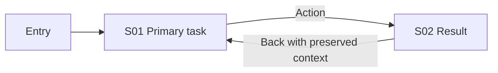

# Concept v001 — Name and scope

Status: draft. Fillable template, not a ready or approved concept.

## Business and basis

Roles, primary jobs, entry/success conditions, known constraints. Brief source: user description or target README/product docs with commit. Read previous concepts/accepted ADRs and explain applicability.

## Research coverage

Distinct products R1…R4, relevance, links/cards, access methods/limits. Default 4; minimum 3 with explanation. Fewer than three means incomplete. Separate facts, screenshot observations and inference; no measured-usability claims without tests.

## Screen and journey catalog

| Screen ID | Role / goal | Existing/reuse/change/new | Card and journey links | States | Desktop/mobile/tablet | ADR |
|---|---|---|---|---|---|---|
| S01 | Fill | Fill | Fill | Applicable | Schemes/rules links | Fill |

Each in-scope screen gets a separate card using the [template](screen.md); explain inapplicable areas explicitly rather than leaving blanks. Journey flows reference actual Screen IDs. Explain reuse/new through reuse-map.

## Journey overview

Illustrative diagram: replace for the project:

## Main decisions

Link canonical `.palarran/<area>/<task>/decisions/`; explain screen/block ordering with evidence observation IDs and limitations. Keep UI copy short; do not insert this rationale into screens.

## Checks and open questions

Coverage, diagram parse/render, expert walkthrough/adaptation and actual prototype tests get separate PASS/FAIL/NOT RUN with evidence. Identify specific user questions about unclear processes. Review-ready requires mandatory coverage checks; approved requires actual approval.

## Revision/handoff

Parent revision, supersedes/reuses, affected Screen IDs, changes/reasons. Links for UX catalog/next tasks; do not overwrite earlier revisions.
