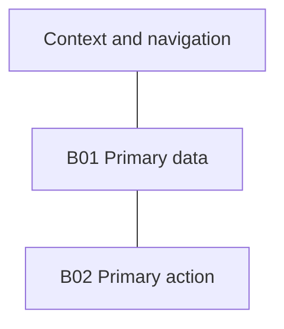
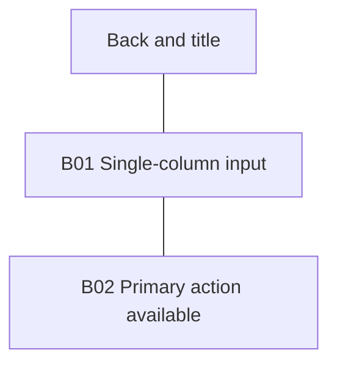
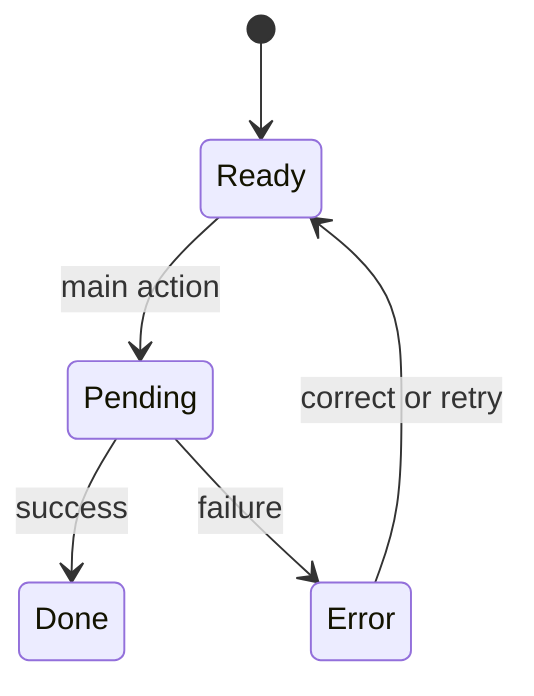

# S01 — Screen name

Status: proposed/draft. Replace the example with an actual screen; goal/role/permissions are mandatory.

## Task and navigation

Role/goal, entry/deep link/preconditions, main action/result, secondary actions, back/cancel/exit and preserved context. Screen ID and related journey IDs.

## Blocks and concise UI copy

| Block ID | Purpose / priority | Reading/focus order | Exact short labels/actions | Visibility conditions |
|---|---|---|---|---|
| B01 | Primary inputs | 1 | Task-specific labels | Fill |
| B02 | Result/primary action | 2 | Short CTA | Fill |

## Desktop layout

`---` denotes adjacency/order, not user transitions. This is semantic structure, not visual design:

## Mobile layout

## Adaptation

For each block: move/collapse/show/omit with alternative routes; tablet transitions; narrow/reflow/long content; keyboard/touch; safe areas/virtual keyboards; scroll/sticky/focus. Matching desktop/mobile layouts are valid with justification, never automatic proof of responsiveness.

## States and transitions

Illustrative graph: replace/extend for actual processes; static screens explain N/A rather than inventing async logic:

| State ID | Trigger/guard | Visible blocks and concise status | Actions/target | Data/focus preservation/recovery |
|---|---|---|---|---|
| S01.ready | Fill | Fill | Fill | Fill |

Include applicable loading/empty/error/permission/validation/success states. Repeated actions must not duplicate side effects. Every Screen/State target exists or is explicitly unresolved.

## Rationale

Explain block ordering/adjacency and primary actions briefly; reference observation IDs, ADRs, reused screens/blocks or reasons for new ones. No visual tokens/production CSS here.

## Review

Desktop/mobile/tablet walkthroughs, keyboard/back/error paths, microcopy, diagram parse/render and prototype checks: PASS/FAIL/NOT RUN. Never present unknown business behavior as accepted requirements.
