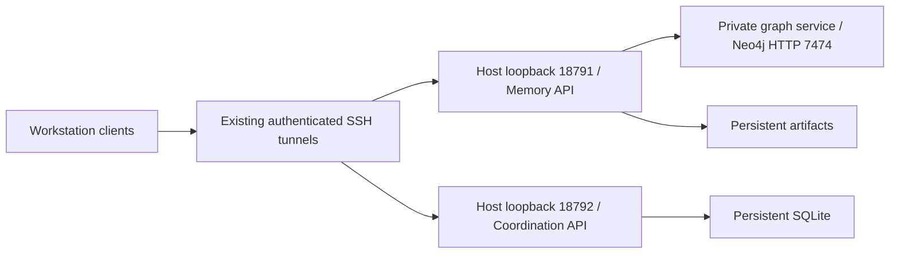

# Container hosting for the Palarran services

This capability packages three separate processes: Neo4j Community, the existing Memory HTTP API, and the existing coordination bus. It does not install skills, agents, MCP clients or the complete framework on a server. The [versioned runbook](runbook.md) is mandatory before host actions; [sources](sources.md) records image/platform provenance and limits.

Only the two API ports are published, both on host `127.0.0.1`. The database has no published port. The graph joins only the dedicated internal `private` bridge. Memory joins `access` and `private`; coordination joins only the standard `access` bridge and cannot directly reach the graph. The API access bridge permits outbound network traffic; this deployment does not enforce global egress denial or change the host firewall. Distinct non-root UIDs, dropped capabilities, no-new-privileges, PID/memory/CPU limits and bounded container logs apply. API root filesystems are read-only, with only their state mounts and bounded tmpfs writable. Neo4j's vendor entrypoint needs a writable configuration area, so its root filesystem is not declared read-only; it still runs non-root with restricted capabilities. This exception is explicit, not a claim of an immutable database container.

Default standalone APIs remain loopback-only. An explicit `--container-network` option permits container-interface listening; Memory's corresponding database exception admits only `http://graph:7474`. Compose supplies the isolation and loopback publishing; the flag cannot prove that an arbitrary caller used those controls. Never use it for a public host service.

Memory config and coordination credentials are mounted from distinct private directories. Image layers, Compose values and Docker-inspectable environment/argv contain protected file paths, never their values. The API adapter does not export credentials; Neo4j's vendor entrypoint may load file secrets into its own process environment, so process-environment dumps remain forbidden. The database uses its supported `NEO4J_AUTH_FILE` mechanism. Local Compose file secrets are bind mounts, so host numeric ownership must match the container UID; a YAML `uid` field must not be assumed to repair ownership. Private artifact/SQLite/graph state persists across container replacement. Credentials and data never enter image build context or Git.

The coordination image compiles the separately supplied, hash-verified SQLite 3.51.3 archive with the existing reviewed builder in a non-root build stage. The runtime uses only that resulting private library and checks the loaded version/source identity at startup. Base Python's bundled SQLite is not trusted as proof of the WAL fix. Build success, liveness, business acceptance, migration and rollback remain distinct gates. This initial source is offline-tested only until the operator records an actual image build and target acceptance.
