# ML architecture and reproducibility

Palarran orchestrates reviewed external jobs; it is not a tensor-training framework, model registry or inference server. Existing local/Modal execution, spending reservations, unknown-outcome reconciliation and diagnostics remain authoritative. This change extends the existing data preparation and benchmark verifier, without a new datastore or framework.

```mermaid
flowchart LR
    R[Local source registry and protected fingerprints] --> P[Pinned split recipe]
    S[Authorized JSONL snapshot] --> C[Validate rights and exact payloads]
    P --> C
    C --> D[Dedup and grouped splits]
    D --> B[Protected benchmark check]
    B --> M[Immutable shards and dataset manifest]
    M --> T[Real local tokenizer and collator]
    T --> X[Seeded whole-example mixture]
    X --> V[Independent regeneration receipt]
    V --> F[Approved fit with same budget]
    F --> E[Frozen baseline and candidate evaluation]
    E --> O[Accept, reject or inconclusive report]
```

Implementation: [data helper](../scripts/ml_data.py), [text gate](https://github.com/zxc0zxc0zxc/palarran-framework/blob/e0208a670c32c35f43df7cde1ba3eacc3345ed85/packages/machine-learning/experiments/runtime/ml_data_gate.py), [lineage and benchmark](https://github.com/zxc0zxc0zxc/palarran-framework/blob/e0208a670c32c35f43df7cde1ba3eacc3345ed85/packages/machine-learning/experiments/runtime/ml_artifacts.py), [compiler](https://github.com/zxc0zxc0zxc/palarran-framework/blob/e0208a670c32c35f43df7cde1ba3eacc3345ed85/packages/machine-learning/experiments/runtime/ml_pipeline.py), [accounting](https://github.com/zxc0zxc0zxc/palarran-framework/blob/e0208a670c32c35f43df7cde1ba3eacc3345ed85/packages/machine-learning/experiments/runtime/ml_resources.py), [diagnostics](https://github.com/zxc0zxc0zxc/palarran-framework/blob/e0208a670c32c35f43df7cde1ba3eacc3345ed85/packages/machine-learning/experiments/runtime/ml_diagnostics.py). Compatibility entrypoints under root scripts/orchestrator remain unchanged.

## Data and policy identity

An optional `provenance` object in the existing pinned split recipe carries a source registry and protected benchmark fingerprints. It is a local snapshot, not an online registry. It is checked before creating outputs. Unknown, blocked, withdrawn or changed-rights sources require a new reviewed recipe; old artifacts are never silently rewritten. There is no automatic upstream removal/license monitoring. Operators must refresh policies and create a new run revision when rights change. A source snapshot does not itself prove legal authorization.

The manifest separates raw input SHA (byte/order-sensitive), logical `dataset_id` (accepted document payload hashes, stable document IDs, source revisions and split membership), and `provenance_sha256` (full registry/policy including timestamps/approvals). Observational ingestion timestamps do not alter logical dataset identity. Revision/license/rights changes remain visible in provenance; source revision/content/split changes alter logical identity. Source processing is `identity-v1`: no whitespace folding, lowercasing, Unicode normalization or truncation. Stable content SHA covers exact canonical text/chat payload, while original record IDs and source revisions remain traceable.

The manifest stores each accepted document's content hash, record hash, source revision and split. It stores counts and hashes of exclusions without logging content. Existing bounded immutable output creation and shard/ledger hashes remain in force. Independent verification checks the optional metadata against actual prepared records and recipe snapshot. A legacy manifest without a provenance policy remains readable; registry and external decontamination are NOT_RUN.

## Experiment lineage and failure boundaries

The existing immutable experiment stage references, prefix digest, execution policy, file pins, tokenizer/backend hashes, prepared receipt, checkpoint hash and evaluation protocol form the experiment record. Dataset identity/provenance now travel inside the same hashed preparation receipt; no competing experiment database is introduced. The preparation lineage file records exact dataset/recipe/tokenizer/template/mixture and processing versions. Generic framework/hardware claims remain unknown unless the target trainer records them through its existing run manifest/diagnostics.

A benchmark may include typed failure counts: model failures, invalid outputs, scoring failures, infrastructure failures and timeouts. Infrastructure/scoring/timeouts make the result inconclusive; they are never scored as model successes or quality regressions. Model/output failures stay in the declared evaluation denominator and must affect task-specific metrics. Missing categories are not silently synthesized for legacy reports. No model promotion or production readiness is inferred from structural verification.

## Storage and compatibility

All raw/prepared data, registry snapshots, fingerprints, receipts, checkpoints and run reports are private artifacts. They do not belong in Git or a public tracker. Examples/tests use owned synthetic records. Content hashes and token arrays are not anonymization. The optional registry adds no model, cloud, graph, Parquet or classifier dependency. Limits remain local JSONL CPU limits; Modal text materialization and full optimizer/RNG resume remain unimplemented.

The six stage lineage bodies remain largely opaque references: generic runtime does not yet schema-enforce every experiment seed, model/base revision, parent checkpoint, framework/hardware or raw per-example evaluation record. These are explicit gaps, not implemented model lifecycle features. Existing approved target manifests must supply them; full schema enforcement and per-example baseline pairing are follow-ups.
