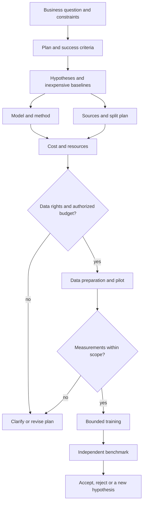

# ML: from a question to a verified experiment

This is the mandatory foundation for ML skills. First read this route, [workflow](workflow.md), [contracts](contracts.md), [cases](cases.md), [sources](sources.md) and the selected stage's guide. Missing documents are blockers; general model memory cannot replace them. Read specialist guides as needed: a classifier does not need all LLM post-training material.

| Command | Output | Boundary |
| --- | --- | --- |
| `/palarran:ml:plan {task}` | [Experiment spec, gates, budget and DoD](plan.md) | Planning only |
| `/palarran:ml:hypotheses {problem}` | [Testable H-IDs, baseline, ablations](hypotheses.md) | No computational search |
| `/palarran:ml:model {task/plan}` | [Baseline, model and method selection](model.md) | No weight downloads/training |
| `/palarran:ml:data {plan}` | [Discovery, dataset card, split/quality recipe](data.md) | Research by default; `--prepare` for authorized preparation |
| `/palarran:ml:cost {plan}` | [Modal low/base/high estimate and caps](cost.md) | Offline calculation, not a GPU pilot |
| `/palarran:ml:train {plan}` | [Launch, training and monitoring](train.md) | `--plan` does not launch; `--status` is read-only for an authorized run |
| `/palarran:ml:benchmark {checkpoint/plan}` | [Baseline comparison under a frozen protocol](benchmark.md) | `--plan` is protocol only; execution in an authorized environment |

Codex uses `$palarran-ml-plan`, `$palarran-ml-hypotheses`, `$palarran-ml-model`, `$palarran-ml-data`, `$palarran-ml-cost`, `$palarran-ml-train`, `$palarran-ml-benchmark`. Slash adapters are a Claude interface, not built-in Codex commands. Standalone skills are independent; an explicit [runtime pipeline](pipeline.md) connects them into seven preparation stages and two supervised execution tasks: local or [Modal Sandbox](modal-adapter.md).

The sequence allows iteration: a license finding or insufficient memory changes the model/cost revision. No automatic skill-call chain, hyperparameter search until budget exhaustion or transition from benchmark to deployment.

## Basis of the approach

[Karpathy, Recipe](https://karpathy.github.io/2019/04/25/recipe/): inspect data, debug a simple pipeline, fit a tiny set, then add complexity. Transfer the diagnostic sequence; do not treat 2019 advice about specific architectures/unsupervised learning as today's universal truth. [Google Rules of ML](https://developers.google.com/machine-learning/guides/rules-of-ml) supports a simple first baseline and checks of training-serving consistency. Our recommendation: allow “training is not needed yet” and spend on more useful data/evaluation.

The suite covers tabular, ranking/retrieval, time series, CV/audio and LLM tasks; select methods with the [model guide](model.md). A skill need not choose the largest model or a GPU. A good outcome is an explained, evidence-backed decision, including a negative experiment.

## What to preserve

In target `.palarran/ml/<task>/`: context, decisions, immutable revisions, progress, safe reports and handoff. Code belongs in the project's normal source tree; large/sensitive data and weights belong in an authorized artifact store. The [contract](contracts.md) connects plan → data/model/config → attempts → checkpoint → benchmark. [Templates](../templates/experiment.md) neither launch training nor provide a ready target configuration.

Suite DoD: each stage output includes references/versions/evidence/unknowns, explains case applicability, records decisions before dependent changes and hands off the next step. `planned`, `running`, `trained`, `benchmarked` and `accepted` are separate states. Falling loss does not prove product usefulness; a lab benchmark does not establish production SLOs.

## Data and capability preservation

[Data preparation](data/README.md): scientific data-first planning, cleaning/exact dedup/grouped splits, joint domain/language token exposure, general capability preservation and complete answers. Existing `/palarran:ml:data` is extended; research/--plan defaults do not invoke helpers.

## Training diagnostics

[Training debugging design](debugging/README.md): task-specific metrics, tracked heuristics, full generation snapshots and a mandatory rolling/terminal report for every outcome. Status design-v001; runtime integration [pending](debugging/integration-plan.md).
