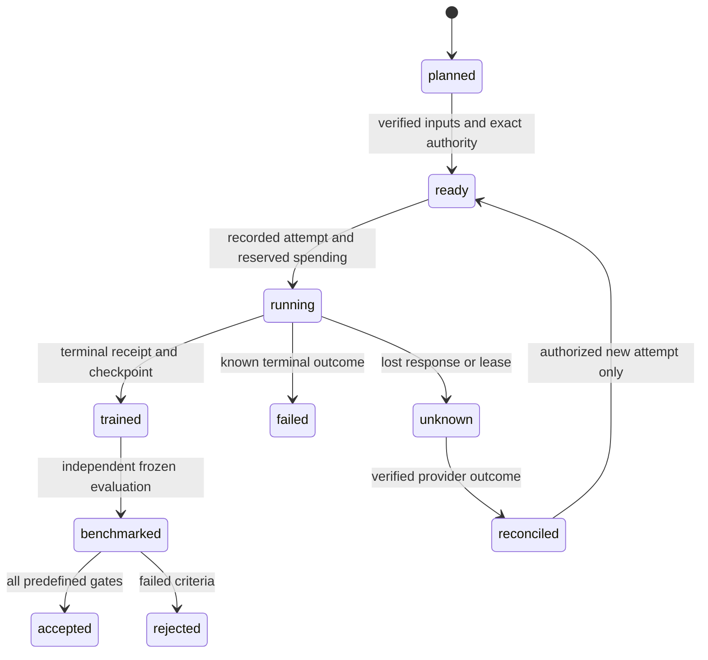

# ML workflow, authority and memory

## Before choosing an experiment

Resolve the target root separately from the installed checkout; read target README, ML code/config, `.palarran/INDEX.md`, relevant accepted ADRs and earlier negative results. Do not scan the whole archive or download weights to understand the project. Record reused IDs, current commit/dirty-patch fingerprint, facts and unknown requirements. If prediction unit/label/product goal is unclear, ask a focused question while continuing independent source review.

The shared [decision-memory contract](../../../core/agents/docs/decision-memory.md) applies. Dataset, model, metric, split, compute, stopping and final interpretation choices need concise rationale/evidence/alternatives/consequences **before** dependent action. These are engineering explanations and observable steps, not private reasoning traces.

## Modes

Plan/hypotheses/model/cost: local context + public official research + planning artifacts/aggregate calculations. No dependency installs, weight/dataset-shard downloads, training/eval/application execution or cloud resource creation. Public pricing pages may refresh cost assumptions; an estimate request does not imply account billing/API calls.

`--plan` for data/train/benchmark preserves the same boundary. Data defaults to a source catalog/recipe; `--prepare` permits only agreed data volume, storage and local processing. Protected/paid corpora, cloud uploads and synthetic generation through paid APIs need corresponding scope and budget. Never request secrets in chat; use existing secret managers/environments without printing values.

Train without `--plan` prepares a concrete reviewable run and executes it if the current request already authorizes that experiment/config/compute/budget. Without authorization, prepare the launch packet first and ask only for missing permission; do not ask again for already authorized actions. A historical “run authorized” ADR is not fresh authority. “Create ML skills” does not authorize training. `--status` only reads the specified accessible run; no job/volume/tracker creation or resume.

Benchmark without `--plan` may execute the approved protocol in the existing authorized local environment. Do not create Modal/GPU jobs, paid LLM judges or external uploads without budget/scope. Without a runtime preserve the ready protocol as not_run; never pretend to measure results.

## Plan and progress

Canonical `.palarran/ml/<task>/progress.json` and the source plan retain revision, tasks and remaining gates. The coordinator updates the ledger and derived plan table; each task has `pending/running/completed/blocked`, evidence refs and checked-subject fingerprint. A dashboard is not another independent truth. This is an ML protocol: existing `execution_progress.py` serves backend/frontend and does not automatically apply here.

The experiment spec gets an immutable revision/hash. Changing source/model/data/tokenizer/split/hyperparameters/metrics creates a new revision; prior PASS is not inherited without impact review. One run attempt binds one hash set. Never retroactively change a threshold to pass an already viewed test.

An unknown outcome blocks another run: reconcile provider job ID, checkpoint and spending first. Do not remove failed/rejected results from comparisons or budgets. Resume is a new attempt with a parent, shared ceiling and verified checkpoint, not a new free history.

## Handoff

Hand off source refs/ADR/H-IDs, checkpoint URI+hash without tokens, measured metrics with sample sizes/units, all attempts/cost dispositions, implemented/verified/not-run distinctions, blockers and the cheapest next test. Update target INDEX. Plan-ready/trained does not authorize deployment/publication/model upload; data is not sent to an external tracker by default.
