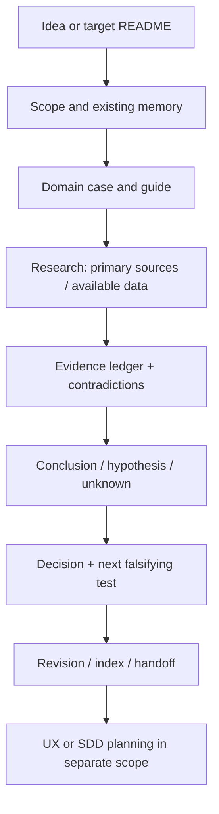

# Product workflow, memory and handoff

Start with [shared memory](../../../core/agents/docs/decision-memory.md), the target README and product/UX/backend/frontend indexes/accepted ADRs. The installed skill checkout and target project are different roots. Write research/decisions/outputs to the target, not the plugin. Standalone invocation does not start other stages. The explicit [pipeline](pipeline.md) sequentially connects five skills and synthesis in the existing runtime; it does not enable an infinite product loop.



1. Define the request for one skill, target root, chosen product/alternatives, region/language/time window and resource envelope. Unknown business/critical scope ambiguity requires one specific question; continue available context/research. Preserve user-supplied alternatives and explain expansions.
2. Read the mandatory case + domain guide + evidence/data-sources; identify the case used and **why it applies/what not to transfer**. A successful company alone is insufficient justification.
3. Reuse target research revisions after checking freshness. Gather bounded evidence: primary/official disclosures first, estimated providers subject to access/budget next; record actual queries/statuses/coverage and inaccessible gaps. Never simulate interviews, account use or a connected API.
4. Build the domain report/diagrams/ledger and decision options. Explicitly link E→H→Decision→Test IDs. Before dependent changes, record each accepted decision in a canonical ADR with rationale/evidence/alternatives/consequences; unresolved remains proposed. An agent recommendation is not user consent to spend/publish.
5. Check research DoD: all material numbers/source dates/definitions, arithmetic/units, contradictions, case applicability, existing context, unresolved blockers and proposed experiments. Missing evidence requires honest unknown/conditional conclusions. A short summary does not replace the ledger.
6. Preserve each revision without overwriting history; update the shared INDEX and product catalog/handoff. New sources/decisions mark affected downstream UX/UI/SDD artifacts as needing review; do not rewrite them automatically. Research complete is not market validated, build-ready or deployed.

```text
.palarran/product/
  INDEX.md
  <task>/
    context.md
    decisions/                      # canonical accepted records
    revisions/v001/
      report.md                     # domain output / scoped question
      evidence.md                   # E-IDs, method, dates, limits
      handoff.md                    # recommendation, dependencies, blockers
      artifacts/                    # safe charts / permitted aggregates
    scratch/                        # temporary; not durable context
```

Target `.palarran/INDEX.md` holds canonical decision links; product INDEX catalogs report revisions/scope/status/dependency references, not a second ADR journal. A linked report from another task needs an explicit path/revision/date, not an implicit latest version. Shared handoff: what was researched, actual evidence/queries/API status, remaining unknowns, source revisions, decision owner, next cheapest test, limits/permissions and downstream applicability.

`research_complete` is possible with explicitly unknown revenue: a good report need not invent an unavailable number. However, a critical input to a specific build/test decision keeps that decision conditional/needs_input. Reports cannot automatically start experiments/engineering without the corresponding scope.

## First customers and cost

Before implementation apply the [go-to-market checkpoint](go-to-market.md), [small B2B](b2b.md) or [B2C](b2c.md), [price register](pricing.md) and [dated sources](go-to-market-sources.md). After polish update revision/offer/quotes. An unknown budget means cash cap=0; unknown price does not mean free, and Similarweb N/A does not mean zero. Outreach/purchasing remains a separate future scope.
