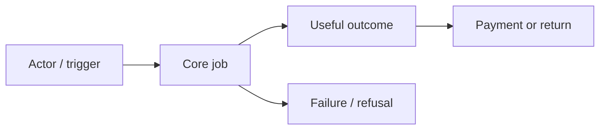

# Product brief — <product> / <revision>

Status: draft. Target/source refs/as-of: fill from actual context.

## Customer and problem

ICP, user/buyer/approver, job/trigger, current workaround, problem frequency/severity, supporting/contradicting E-IDs. Open questions and constraints.

## Offer

Value proposition; candidate wedge and switching costs; business model/paid unit/price hypothesis; MVP end-to-end outcome; scope/non-goals and AC IDs. Applied case → applicability → what does not transfer.

## Metrics and validation

| H-ID | Claim / E-IDs | Metric / unit / cohort / window | Proposed success / stop | Cheapest test / owner / cap | Actual status |
|---|---|---|---|---|---|
| H-01 | fill | fill | justify | plan only | not_run |

## Business flow

Replace the diagram with actual business behavior; mark unknown transitions.

## Decision and handoff

Build/test/stop recommendations with E/H/ADR refs, owner and unresolved blockers; product/market/compare/revenue/acquisition revisions. Next UX/SDD scope and permissions, no automatic execution.
