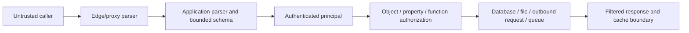

# Ingress and input-boundary audit

`/palarran:security:ingress {scope?}` audits how untrusted input reaches application behavior. It covers browser forms and every equivalent server entry point, not only a reverse proxy or Kubernetes Ingress. Read the [shared audit/evidence contract](../../shared/docs/contract.md), [source catalog](sources.md), actual project instructions and accepted decisions first. Default work is bounded local source/configuration review and public-source research. `--plan` prepares scope and an evidence/test plan from available context without application/scanner execution, remote calls or application/configuration changes. Local source/document inspection and inert private planning artifacts remain allowed. Never infer permission for traffic, installations, fixes, exploits or deployment from an audit request.

## Build the entry-point ledger

Pin the target repository revision and relevant dirty-file hashes, framework/runtime versions, reviewed configuration and evidence date. Identify which topology is observed in configuration and which remains a deployment assumption. Record each input surface and a concrete coverage disposition, including surfaces absent only after an explicit search:

| Surface | What to trace |
| --- | --- |
| Forms and direct APIs | UI field → actual method/path/controller/action → parser/validator → authentication → authorization → sink; include alternate routes and versions |
| Server-only actions and RPC | Exported actions, GraphQL resolvers, gRPC messages, WebSocket upgrades/messages and internal HTTP endpoints reachable through another service |
| Upload/import/export | Multipart handlers, archive extraction, image/document conversion, CSV import, generated download identifiers and object-storage callbacks |
| Webhooks/integrations | Public callback route, provider signature verification, raw-body handling, delivery identity, replay/idempotency behavior and downstream queue |
| Headers, URL and proxy metadata | Path/query/fragment usage, forwarded host/protocol/client IP, cookies, content negotiation, redirects, CORS and cache identity |
| Non-browser producers | Queue consumers, scheduled imports, CLI/config readers and partner APIs whose content becomes application input; distinguish these from network ingress |

Use a finite inventory with route IDs, path/line references, owner, expected caller, sensitive operation, limits and review state. Missing generated routes/dynamic registrations remain gaps. Do not invoke route generators or import application modules merely to enumerate handlers: imports can execute code. A discovered UI form is not proof that its server path is protected; Vercel's [Next.js guide](https://nextjs.org/docs/app/guides/data-security) treats actions as independent request entry points.

Adapt this diagram to actual components; label unobserved topology as proposed. Trust boundaries must show proxy-to-app identity propagation and any alternate path that bypasses the normal edge.

## Review each boundary

1. **Parsing before business use.** Trace body/content-type handling, duplicate fields/JSON keys, number coercion, null/missing distinctions, nested objects, Unicode/canonicalization, URL decoding and multipart behavior. Inspect byte limits before buffering, decompressed size, field/array/depth limits, per-file and aggregate limits, parser timeouts and expensive regexes. The chosen limits need a business reason and exact units; an absent limit is not a measured denial-of-service result. Treat syntax validation, semantic consistency and authorization as different checks, following [OWASP input validation](https://cheatsheetseries.owasp.org/cheatsheets/Input_Validation_Cheat_Sheet.html).
2. **Sink-specific protection.** Follow validated values to SQL/NoSQL/query builders, templates/HTML/DOM, paths/archive members, command arguments, deserializers, redirects and server-side outbound URLs. Prefer parameterized APIs/contextual encoding and confined filesystem/destination access. A character blacklist or frontend validator cannot establish safety. For SSRF, inspect redirects, DNS/address changes and cloud metadata/private ranges in the actual fetch path; do not make probing requests during review.
3. **Authentication and business authorization.** Check the real handler and data-access operation for the requested object/action, including tenant scope and projected response properties. User-controlled owner/role/price/tenant fields must not become authority. A session cookie, unpredictable ID or valid schema is insufficient. Link deeper object/function/property review to [code audit](../../code/docs/README.md), preserving shared finding IDs rather than duplicating claims.
4. **Browser boundaries.** Review state-changing methods, framework CSRF configuration, tokens and origin validation for the actual authentication mechanism. CORS controls browser cross-origin access; it does not authenticate clients or replace authorization/CSRF protections. Check origin allowlists, credentialed responses, null origins, preflight/actual-response differences, trusted subdomains and cache variation. Cookie flags and SameSite are contextual defenses, not an automatic all-route proof; use the [OWASP CSRF guide](https://cheatsheetseries.owasp.org/cheatsheets/Cross-Site_Request_Forgery_Prevention_Cheat_Sheet.html).
5. **Proxy trust and framing.** Identify each proxy/server implementation and version, accepted forwarded headers, trusted peer ranges, host/protocol normalization and the direct-backend path. Do not trust unsigned identity headers supplied by arbitrary callers: [Google IAP](https://docs.cloud.google.com/iap/docs/signed-headers-howto) provides a concrete signed-assertion example, not a mandate to adopt Google infrastructure. Review parser agreement over message boundaries/length/transfer coding, protocol conversion and malformed-header rejection against [RFC 9112](https://www.rfc-editor.org/rfc/rfc9112.html). Source review can flag suspicious framing; only authorized isolated evidence could confirm a deployment-specific request-smuggling condition. Never send desynchronization payloads to a live/shared endpoint under this audit.
6. **Uploads and signed callbacks.** Inspect content validation beyond claimed extension/MIME, server-generated names, traversal/symlink/archive confinement, storage outside executable/public paths, processing privileges and download authorization. Bound expanded archives and conversion work. A malware scan or extension allowlist alone is insufficient; see [OWASP uploads](https://cheatsheetseries.owasp.org/cheatsheets/File_Upload_Cheat_Sheet.html). For webhooks, verify the provider's exact signed bytes before parsing/mutation, compare signatures safely, inspect timestamp/replay rules when supplied and durable event-id deduplication. [GitHub's delivery validation](https://docs.github.com/en/webhooks/using-webhooks/validating-webhook-deliveries) supports signature review; signature validity alone does not make duplicate business mutations safe.

## Edge cases and review handoff

Create a test **proposal**, not a report of executed attacks. Cover missing/null/empty/extra fields; wrong scalar types; numeric boundaries and overflow; maximum byte/character/depth limits; encoded and duplicate parameters; mixed content types; alternate methods/routes; cross-origin cookie use; forged proxy headers/direct backend; altered/replayed callbacks; foreign upload/download IDs; and partial parser/storage failures. Include legitimate Unicode and valid maximum-size inputs as controls. Each case names preconditions, exact subject, expected denial/allow result, expected absence of side effects, proposed environment and evidence needed.

If actual read-only or isolated test execution is separately authorized, preserve its concrete scope, rate/size limits, test identities, commands/tool versions, timestamps and observations. Unsafe upload processing, smuggling, SSRF, load and exploit tests are not ordinary inspection. Do not execute project tools or network requests merely because a test matrix exists.

Deliver the shared report with entry-point coverage, trust-boundary diagram, prioritized findings, uncertainty, remediation proposals and explicit NOT_RUN gaps. Bind each issue to input→transform→sink/authorization evidence and a practical impact scenario; a pattern match is a candidate until contextual review. No generic claim that all inputs are secure. Record accepted rationale, reused ADRs, index and handoff under the **target** private `.palarran/security/` area, following the shared contract. Artifact prose uses project `languages.docs`; canonical guides remain English.
