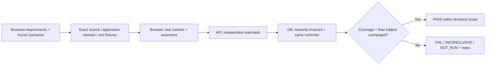

# Independent application acceptance

`/palarran:app:verify {target/scenarios} [--plan]` maps business requirements to independent checks appropriate to the application. Start with the [small-task entry](../../../core/agents/docs/task-context.md) and target instructions; do not load every adapter contract for a small server-side review.

## Choose the relevant surface

| Target | Read next | Evidence boundary |
| --- | --- | --- |
| Server, worker or bot with existing tests | [Project tests](project-tests.md) | Requirement-linked test/fixture outcomes, exact clean Git source; no automatic application acceptance. |
| Web application using browser/API/DB | Relevant [methodology](methodology.md), [contract](contract.md), [operations](operations.md), [evidence](evidence.md), [sources](sources.md) sections | Actual observations of required surfaces and the same entity/version. |
| Other databases, native/mobile or remote environments | Existing authorized domain tools and an explicit protocol | Unsupported automatic adapters stay NOT_RUN; do not invent their implementation. |

The original web CLI supports trusted local HTTP, optional existing Playwright Chromium and readonly SQLite. The project-tests adapter also runs existing reviewed commands without requiring those technologies. Both install nothing and add no model/paid-judge calls. An arbitrary project command can still have external effects; review its dependency/fixture scope before execution.

The app portable package includes CLI source, templates and Node bridge. Operators install browser dependencies separately; missing browser means NOT_RUN, not an HTTP substitute. Captured screenshots are not visual review. Fixture PASS establishes no scientific/operational SLA, security audit or production readiness.
