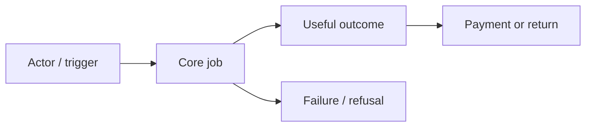

# Product brief — <product> / <revision>

Status: draft. Target/source refs/as-of: заполнить по actual context.

## Customer и проблема

ICP, user/buyer/approver, job/trigger, current workaround, problem frequency/severity, supporting/contradicting E-IDs. Открытые вопросы и ограничения.

## Предложение

Value proposition; candidate wedge и switching costs; business model/paid unit/price hypothesis; MVP end-to-end outcome; scope/non-goals и AC IDs. Applied case → применимость → что не переносим.

## Metrics и validation

| H-ID | Claim / E-IDs | Metric / unit / cohort / window | Proposed success / stop | Cheapest test / owner / cap | Actual status |
|---|---|---|---|---|---|
| H-01 | заполнить | заполнить | обосновать | plan only | not_run |

## Business flow

Заменить diagram по actual business; unknown transitions отметить.

## Decision и handoff

Build/test/stop recommendation с E/H/ADR refs, owner и unresolved blockers; product/market/compare/revenue/acquisition revisions. UX/SDD next scope и permissions, без automatic execution.
