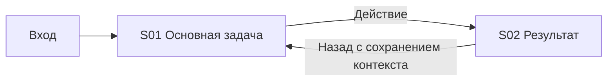

# Concept v001 — Название и scope

Статус: draft. Это заполняемый шаблон; не готовый или approved концепт.

## Бизнес и основания

Роли, primary jobs, входы/успех, известные constraints. Источник brief: описание пользователя либо target README/product docs с commit. Прочитанные previous concepts/accepted ADR и что из них применимо.

## Research coverage

Список разных продуктов R1…R4, relevance, links/cards, методы доступа и ограничения. Default 4; minimum 3 с объяснением. Меньше трёх — incomplete. Facts, screenshot observations и inference разделены; нет заявлений о measured usability без tests.

## Screen и journey catalog

| Screen ID | Role / goal | Existing/reuse/change/new | Card и journey links | States | Desktop/mobile/tablet | ADR |
|---|---|---|---|---|---|---|
| S01 | Заполнить | Заполнить | Заполнить | Применимые | Schemes/rules links | Заполнить |

Для каждого in-scope экрана отдельная screen card по [шаблону](screen.md); неприменимые зоны явно объяснить, не оставлять пустыми. Journey flow references реальные Screen IDs. Объяснить reuse/new через reuse-map.

## Journey overview

Учебная схема — заменить под проект:

## Основные решения

Ссылки на canonical `.ai-development/<area>/<task>/decisions/`; причина порядка экранов/блоков, evidence observation IDs и ограничения. UI copy остаётся короткой; этот rationale не вставляется на экран.

## Проверки и открытые вопросы

Coverage, diagram parse/render, expert walkthrough/adaptation, actual prototype testing — отдельно PASS/FAIL/NOT RUN с evidence. Что именно спросить у пользователя о неясном процессе. Review-ready только после обязательных coverage checks; approved — только с фактическим одобрением.

## Revision/handoff

Parent revision, supersedes/reuses, affected Screen IDs, что изменилось и почему. Ссылки для UX catalog и следующей задачи; старую версию не перезаписывать.
