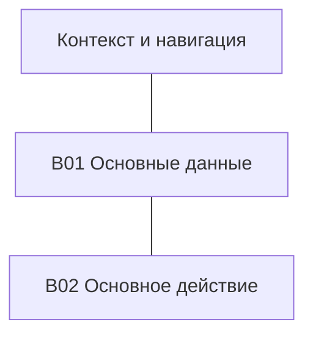
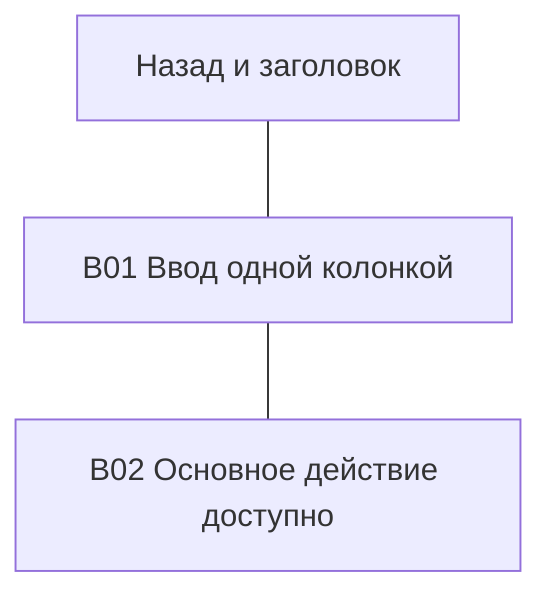
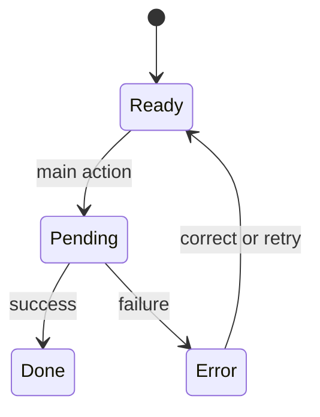

# S01 — Название экрана

Статус: proposed/draft. Заменить пример на реальный экран; цель/роль и permissions обязательны.

## Задача и навигация

Role/goal, entry/deep link/предусловия, main action/result, secondary actions, back/cancel/exit и сохраняемый контекст. Screen ID и связанные journey IDs.

## Блоки и краткий UI текст

| Block ID | Purpose / priority | Порядок чтения/focus | Точные короткие labels/actions | Условия видимости |
|---|---|---|---|---|
| B01 | Основные входные данные | 1 | Подписи по задаче | Заполнить |
| B02 | Результат/основное действие | 2 | Короткий CTA | Заполнить |

## Desktop layout

`---` — соседство/порядок, не пользовательский переход. Схема semantic, не visual design:

## Mobile layout

## Адаптация

Для каждого блока: move/collapse/show/omit с альтернативным путём; tablet transition; narrow/reflow/long content; keyboard и touch; safe area/виртуальная клавиатура; scroll/sticky/focus. Совпавшие desktop/mobile layouts допустимы с объяснением, не как автоматическое подтверждение адаптивности.

## States и transitions

Учебный graph — заменить/дополнить по реальному процессу; статический экран имеет обоснование N/A вместо фиктивной async логики:

| State ID | Trigger/guard | Видимые блоки и короткий статус | Actions/target | Сохранение данных/focus/recovery |
|---|---|---|---|---|
| S01.ready | Заполнить | Заполнить | Заполнить | Заполнить |

Применимые loading/empty/error/permission/validation/success states не пропускать. Повторное действие не дублирует side effect. Все Screen/State targets существуют или обозначены unresolved.

## Почему так

Короткое объяснение порядка/соседства блоков и main action; reference observation IDs, ADR, reuses existing screen/block либо причина нового. Visual tokens/production CSS сюда не входят.

## Review

Desktop/mobile/tablet walkthrough, keyboard/back/error paths, microcopy, diagram parse/render и prototype checks — PASS/FAIL/NOT RUN. Unknown business behavior не выдавать за принятое требование.
